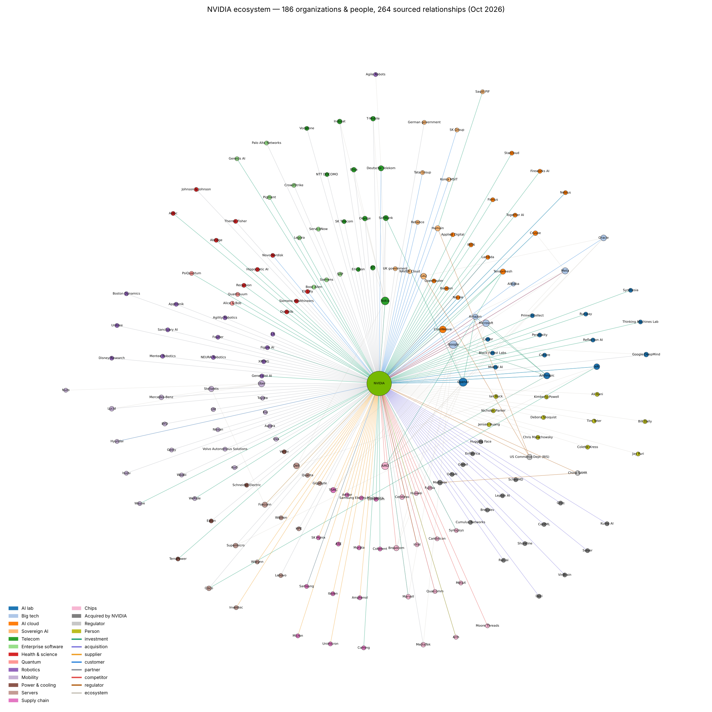

# NVIDIA Ecosystem Network (NetworkX)

A graph of NVIDIA's business relationships, built and analyzed with Python and NetworkX.

- **186 nodes**: companies, governments, regulators and people
- **264 edges**: investments, acquisitions, suppliers, customers, partners, competitors and more
- **86 public sources**, as of October 2026



## Files

| File | What it is |
| --- | --- |
| `nodes.csv` | Each company or person, with category and country |
| `edges.csv` | Each relationship: type, detail, date, source key |
| `sources.csv` | Source key → article title and URL |
| `build_network.py` | Builds the graph, runs the analysis, exports results |
| `nvidia_graph.graphml` | The graph in GraphML (opens in Gephi) |
| `nvidia_ecosystem.html` | Interactive explorer (open in a browser) |
| `nvidia_network_full.png` | Static picture of the graph |

## Run it

```bash
pip install networkx matplotlib
mkdir -p data out && mv *.csv data/
python3 build_network.py data out
```

The script writes the JSON, GraphML and PNG into `out/`.

## What the analysis finds

NVIDIA is removed before analysis, because it connects to almost every node.

- **Bridges (betweenness):** OpenAI and Google tie for first (0.36).
- **Circular deals:** NVIDIA invests in and sells to 9 companies, including OpenAI, Anthropic and CoreWeave.
- **Frenemies:** Google, Amazon, Microsoft and Meta buy NVIDIA chips while building their own.
- **Communities (Louvain):** OpenAI, Google TPU, Nokia telecom and Uber robotaxi blocs.

## Limits

This is a curated sample, not a complete map. Scores depend on which relationships were collected.
